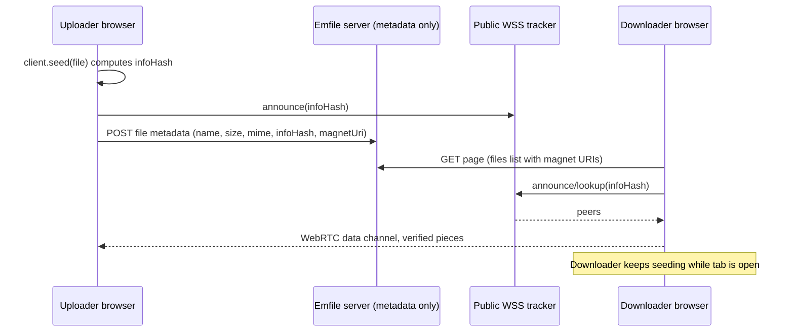

# Emfile — Master Build Prompt

> **Paste this entire document to a coding agent.** It is designed to be built in one pass.

You are a senior full-stack engineer. Build **Emfile** end to end: a fast, minimal, modern web app, "a linktree for files", where anyone can upload files and get a shareable page. File bytes travel **peer-to-peer in the browser**; the server hosts only the site and small metadata.

Read this whole spec before writing code. Where the spec is silent, make a sensible decision and record it in the README. Do not ask questions. Do not stub features: everything in scope must work.

---

## Contents

1. [Product summary](#1-product-summary)
2. [Non-negotiables](#2-non-negotiables)
3. [Tech stack](#3-tech-stack-use-exactly-these)
4. [P2P file layer](#4-p2p-file-layer-webtorrent)
5. [Access model](#5-access-model-single-source-of-truth)
6. [Data model](#6-data-model)
7. [API](#7-api)
8. [Routes and UI](#8-routes-and-ui)
9. [Security](#9-security)
10. [Performance](#10-performance)
11. [Deployment](#11-deployment-vercel-first)
12. [Repo layout](#12-repo-layout)
13. [Build order](#13-build-order)
14. [Definition of done](#14-definition-of-done)
15. [Out of scope](#15-out-of-scope)

---

## 1. Product summary

**Emfile** lets anyone drop a file on the landing page and instantly get a link like `https://emfile.site/file/math-book/`, where `math-book` is a customizable slug.

| Flow | Who | What they can do |
|---|---|---|
| **Anonymous** | No account | Create a page, upload files, set an optional PIN/password to share editing or restrict viewing, or allow anyone to edit with no approval. |
| **Authenticated** | Google or username/password (no email required) | Everything above, plus a **dashboard** to create/update/delete pages, and **private pages** (owner-only view/edit). Anonymous users can never create private pages. |

**Landing page `/`**: a compact **"Go to:"** section for jumping to an existing page by slug (placed above the upload area), then the big dropzone (drag/drop, click, paste). A slug field is pre-filled with a random suggestion (e.g. `quiet-otter-x7k`) and can be edited before creating. An optional "Protect with a PIN" section is collapsed by default.

**File page `/file/<slug>`**: editable title and description, an upload button, and a file list where **every file row has its own Download button**. Text files open in an in-browser editor on **double-click** (desktop) or tap (touch), and the editor follows the browser/OS light or dark theme.

**Cross-cutting requirements**
- Fully responsive, mobile-first. Verify at 375px, 768px and 1280px.
- Light and dark themes that **follow the browser/OS color scheme by default** (with a manual toggle). Every third-party component (CodeMirror editor, `sonner` toasts, dialogs, drawers, scrollbars) must follow the active theme too; none may stay light in dark mode.
- Target Vercel first, but stay portable to any Node host.
- Total running cost: **$0**.

---

## 2. Non-negotiables

- **No file bytes ever touch the server.** No buckets, no upload endpoints.
- **No auth/DB SaaS lock-in** (no Clerk, Supabase, Firebase). Auth and data access are library code inside this repo.
- **Do not reinvent the wheel.** Use the libraries named below. Do not hand-roll auth, password hashing for accounts, torrenting, editors, or UI primitives.
- **Bun is the only JS tooling.** Use `bun install`, `bun add`, `bun run`, `bunx` and `bun test` everywhere. Do not use or mention `pnpm`, `npm`, `yarn`, `npx`, Jest or Vitest, and commit only `bun.lock` (no other lockfile).
- TypeScript `strict`. No `any` without an explanatory comment.
- Every API input is validated with `zod`.
- **All authorization is enforced server-side in one function** (see [§5](#5-access-model-single-source-of-truth)). The client never decides access.

---

## 3. Tech stack (use exactly these)

| Concern | Choice |
|---|---|
| Framework | **Next.js** (latest stable, App Router), TypeScript, **Bun** (package manager, script runner, test runner), Node runtime for route handlers on Vercel |
| Styling / UI | **Tailwind CSS v4** + **shadcn/ui** (Radix), `lucide-react`, `sonner`, `next-themes`, `next/font` (Geist) |
| Sheets/dialogs | shadcn `Dialog` on desktop and `Drawer` (vaul) on mobile |
| Database | **Drizzle ORM + libSQL** (`@libsql/client`, SQLite dialect). Dev: `file:./local.db`. Prod: Turso free tier via `TURSO_DATABASE_URL` + `TURSO_AUTH_TOKEN`. Migrations via `drizzle-kit`, run with `bunx` |
| Auth | **Better Auth**: **username + password** (via its `username` plugin) and Google OAuth, Drizzle adapter, DB-backed sessions, built-in rate limiting using the database as storage. Mounted at `/api/auth/[...all]`. **No email signup, verification or password-reset email in v1** (see "Auth design" below) |
| Access cookies | **jose** (signed JWTs) |
| Validation / ids | **zod**, **nanoid** |
| Client data | **SWR** |
| Text editor | **CodeMirror 6** via `@uiw/react-codemirror`, lazy-loaded language packs, loaded with `next/dynamic` (`ssr: false`). Themes: `@uiw/codemirror-theme-github` (`githubLight` / `githubDark`), switched by the app theme (see "Text editor" under Routes and UI) |
| P2P transfer | **WebTorrent** (browser build) |
| Tests | **`bun test`** (`bun:test`) |

### Bun tooling conventions
- Scaffold with `bun create next-app` and add shadcn components with `bunx --bun shadcn@latest add <component>`.
- Define scripts in `package.json` and run them with `bun run`: `dev`, `build`, `start`, `lint`, `typecheck` (`tsc --noEmit`), `db:generate`, `db:migrate` (`bun run scripts/migrate.ts`), `db:studio`.
- Write one-off scripts (migrations, seeding) in TypeScript and execute them directly with `bun run`.
- Tests live next to the code as `*.test.ts` and import from `bun:test`.
- Set `"packageManager"` and an `engines.bun` range in `package.json`, and document the required Bun version in the README.

### Auth design (username-based, no email in v1)
Emfile v1 sends no email at all, so account creation never asks for one.

- **Sign up and sign in with a username and password.** Use Better Auth's `username` plugin (`signIn.username`). Usernames are case-insensitive and unique, 3–30 chars, matching `^[a-z0-9_.-]+$`, with the same reserved-word list as slugs. Passwords are 8–128 chars.
- **Better Auth's user table requires an `email` column.** Satisfy it internally: on username signup, generate a synthetic, never-displayed address of the form `<random-id>@users.emfile.invalid` (the `.invalid` TLD is reserved and can never receive mail) and pass it to `signUp.email` along with the username. Never show, collect or send mail to this address. Hide it from every UI and API response.
- Configure `emailAndPassword` with `requireEmailVerification: false` and **no** `sendResetPassword` or `sendVerificationEmail` handlers. Do not implement a mail abstraction, Resend or SMTP code.
- **Google OAuth** stays available as the second sign-in method and uses the real email Google returns. Disable automatic account linking between Google and username accounts, since the synthetic address would never match.
- **No account recovery in v1.** Say so clearly on the signup form: *"Emfile has no email, so we can't reset a lost password. Store it somewhere safe."* Offer a password-manager-friendly form (`autocomplete="new-password"`, show/hide toggle).
- Make Better Auth's rate limiting strict on `/api/auth/*` sign-in routes. Return the same generic error for "unknown username" and "wrong password" to avoid username enumeration.
- Keep the auth layer isolated in `lib/auth.ts` so adding email later (verification, reset, email signup) is a small, additive change. Document this in the README.

---

## 4. P2P file layer (WebTorrent)

**Architecture:** the server stores only metadata (name, size, mime, infohash, magnet URI). Peers exchange the actual bytes over WebRTC. Public WebSocket trackers provide signaling.



### Client setup
- Create a `TorrentProvider` mounted in the **root layout**. The WebTorrent client is a **singleton that survives client-side navigation**. Going from `/` to `/file/<slug>` must not interrupt seeding, so use `router.push`, never a full reload.
- **Lazy-load** WebTorrent: dynamic-import `webtorrent/dist/webtorrent.min.js` only on the first file interaction (prefetch on idle or on hover of the dropzone). If the bundler fails on it, copy that file to `/public/vendor/` and load it with `import(/* webpackIgnore: true */ ...)`.
- Trackers and STUN come from env and must be configurable, because public trackers can go down:
  - `NEXT_PUBLIC_TRACKERS` default: `wss://tracker.openwebtorrent.com`
  - `NEXT_PUBLIC_STUN` default: `stun:stun.l.google.com:19302,stun:global.stun.twilio.com:3478`

### Upload
1. `client.seed(file, { announce: trackers })`.
2. On `infoHash` and `magnetURI`, `POST` **metadata only** (`name, size, mime, infoHash, magnetUri`) to the files API.
3. The server validates `infoHash` (40 hex chars), sanitizes the name, and caps its length.

### Download
- `client.add(magnetUri)` with visible states: **Connecting → Found N peers → Progress (%, speed) → Done**, plus cancel.
- Save with `file.blob()` and an anchor download. Use `showSaveFilePicker` streaming for large files when available.
- Use an IndexedDB chunk store if it bundles cleanly. Otherwise use the memory store and show a warning above ~1 GB.
- If there are no peers after ~20 s, show: *"No one is sharing this file right now. Ask the uploader to open this page, or re-seed it."*
- After downloading, keep seeding while the tab is open (default WebTorrent behavior) and say so: *"Helping keep this file alive."*

### Availability mitigations
Pure P2P means a file exists only while at least one peer holding it is online. The UI must make this visible and recoverable:
- **Seed again**: the uploader picks the same file later. The client recomputes the infohash and verifies it equals the stored one (deterministic for the same name, content, and piece length) before seeding. On mismatch, show a clear error.
- A **"Sharing from this tab"** badge on files this tab is seeding, plus a `beforeunload` warning while actively seeding.
- **Do not** auto-join swarms for every file on page load. Connect only on user action.

### Small text files are inline, not P2P
- Text-like files **≤ 256 KB** are stored **inline in the database** (`kind = 'inline'`), so they are always available and instantly editable without a live seeder.
- Text-like means: mime starts with `text/`, or the extension is in a whitelist (`txt, md, json, yaml, yml, toml, csv, log, ini, env`, and common code extensions).
- Everything else, and anything above 256 KB, is `kind = 'p2p'`.
- Provide a **"New text file"** action that creates an inline file directly.

---

## 5. Access model (single source of truth)

### Page fields
`viewPolicy ∈ {public, pin, owner}` · `editPolicy ∈ {owner, pin, anyone}` · `secretHash` (nullable) · `ownerId` (nullable) · `creatorTokenHash` (nullable)

### Roles
Computed per request by one pure function `authorize(page, ctx)` where `ctx = { session?, creatorCookie?, unlockCookie? }`.

| Role | Granted when | Can do |
|---|---|---|
| **admin** | Session user is `ownerId`; **or** page is ownerless **and** (valid creator cookie **or** valid unlock cookie) | Change settings, PIN, slug; delete; claim; everything editors can |
| **editor** | Admin; **or** `editPolicy = anyone`; **or** (`editPolicy = pin` **and** valid unlock cookie) | Change title, description, files |
| **viewer** | Editor; **or** `viewPolicy = public`; **or** (`viewPolicy = pin` **and** valid unlock cookie) | View page and download |

### Invariants (enforce in zod and on the server)
- `view = owner ⇒ edit = owner`
- `view = pin ⇒ edit ∈ {pin, owner}`
- Any `pin` policy requires `secretHash`. The one exception: an ownerless page with no PIN, where only the creator cookie can edit.
- Ownerless pages may never use `owner` policies. Only authenticated users can set `owner` policies.

### Unlock flow
- `POST /api/pages/[slug]/unlock { secret }` verifies with **scrypt** (`node:crypto`, per-secret salt, `timingSafeEqual`).
- On success, set an `httpOnly`, `Secure`, `SameSite=Lax` cookie `mp_u_<pageId>`, a jose-signed token valid for 30 days.
- PIN/password length: **4–128** characters.
- Rate-limit attempts per (IP-hash, page) using DB counters with exponential lockout.
- Locked pages show only a generic unlock screen. Do not leak details beyond what the policy allows.

### Creator cookie
On anonymous page creation, generate a random token, store its hash, and set an `httpOnly` cookie `mp_c_<pageId>`. Show a persistent nudge to set a PIN so access survives a lost cookie.

### Claim
A signed-in user who is admin of an ownerless page can **claim** it: set `ownerId` and clear `creatorTokenHash`.

### UX wording
On anonymous pages, state plainly in the settings UI: *"Anyone with this PIN can edit and manage this page."*

**Write unit tests covering the full policy matrix.**

---

## 6. Data model

Drizzle, SQLite dialect.

**Better Auth tables** (`user`, `session`, `account`, `verification`): follow its docs, generated via its CLI or written by hand to match. Include the `username` plugin's columns (`username`, `displayUsername`) on `user`, with a unique index on the normalized username.

**`pages`**

| Column | Notes |
|---|---|
| `id` | nanoid |
| `slug` | unique, lowercase |
| `title`, `description` | |
| `ownerId` | nullable FK to `user` |
| `viewPolicy`, `editPolicy` | enums per §5 |
| `secretHash` | nullable |
| `creatorTokenHash` | nullable |
| `createdAt`, `updatedAt`, `lastActivityAt` | |

**`files`**

| Column | Notes |
|---|---|
| `id` | nanoid |
| `pageId` | FK, cascade delete |
| `name`, `size`, `mime` | |
| `kind` | `p2p` or `inline` |
| `infoHash`, `magnetUri` | nullable, for `p2p` |
| `content` | nullable, for `inline` |
| `revision` | int, for optimistic concurrency |
| `position` | ordering |
| `createdAt`, `updatedAt` | |

**`rate_limits`**: `key`, `count`, `windowStart`.

**Limits**
- Slug: `^[a-z0-9]+(-[a-z0-9]+)*$`, 3–40 chars. Reserved words blocked: `api, dashboard, login, signup, file, admin, settings, _next, static`.
- Title ≤ 80 chars. Description ≤ 500 chars.
- ≤ 100 files per page.
- Anonymous page creation ≤ 10 per hour per IP-hash.

---

## 7. API

Route handlers, zod-validated, JSON, same-origin checked. **Every handler calls `authorize()`** and returns **404, not 403**, for pages the caller may not know exist.

| Method and path | Purpose |
|---|---|
| `POST /api/pages` | Create a page (anonymous or authenticated) |
| `GET /api/slug-check?slug=` | Slug availability |
| `GET, PATCH, DELETE /api/pages/[slug]` | Read, update (title, description, settings), delete |
| `POST /api/pages/[slug]/unlock` | Submit PIN/password |
| `POST /api/pages/[slug]/claim` | Claim an ownerless page |
| `POST /api/pages/[slug]/files` | Register a `p2p` file or create an `inline` file |
| `PATCH, DELETE /api/pages/[slug]/files/[fileId]` | Rename, reorder, edit inline content with `revision` check (mismatch → `409` and a friendly "changed elsewhere" UI), delete |
| `GET /api/cron/cleanup` | Requires `CRON_SECRET`. Delete ownerless pages inactive > 180 days |
| `/api/auth/[...all]` | Better Auth |

---

## 8. Routes and UI

**Design language:** minimal and airy, generous whitespace, one accent color, `rounded-xl`, subtle borders, restrained motion (respect `prefers-reduced-motion`), 44px+ touch targets, safe-area insets, `dvh` units, full keyboard and ARIA support. Use shadcn defaults; do not invent a design system.

### `/` Landing
Order, top to bottom: headline, **"Go to:" section**, large dropzone, slug field showing `emfile.site/file/[slug]` with a debounced availability check, collapsible PIN section. Creating a page navigates instantly while seeding continues.

#### "Go to:" section (above the upload area)
A small, secondary-weight row that lets a visitor open an existing page by typing its slug. It must be visible without scrolling on mobile and must not visually compete with the dropzone.
- **Layout.** A `<form>` (`aria-label="Go to a page"`) containing the label **"Go to:"**, a text input with a muted, non-editable prefix `emfile.site/file/` (shortened to `/file/` on narrow screens) and placeholder `math-book`, and a **Go** button (arrow icon, `aria-label="Go"`). Desktop: one inline row. Mobile (375px): label above, input and button on one full-width row, 44px+ touch targets. Use shadcn `Input` and `Button`; do not invent a new control.
- **Behavior.** Submitting (Enter or the Go button) navigates to `/file/<slug>` with `router.push` (client-side, so an in-progress seed from the TorrentProvider is never interrupted). The Go button is disabled while the input is empty. Do **not** autofocus the input (it would break paste-to-upload and mobile keyboards popping up on load).
- **Normalization (shared helper `parseSlugInput` in `lib/slug.ts`, unit-tested).** Trim, lowercase, convert spaces to hyphens, drop a trailing slash. If the user pastes a full link (for example `https://emfile.site/file/math-book/` or `emfile.site/file/math-book`), extract the slug from it. Then validate with the same slug regex and reserved-word list used everywhere else. If invalid, do not navigate; show an inline error under the input (`aria-live="polite"`, linked with `aria-describedby`): *"Slugs use lowercase letters, numbers and hyphens (3-40 characters)."*
- **Pasting.** Paste handling for file uploads applies page-wide, **except** when focus is inside this input, where text paste behaves normally.
- **No pre-check request.** Do not call an existence API first. Navigate straight to `/file/<slug>` and let the page handle every state (public, PIN unlock screen, private, not found).
- **Not-found state on `/file/[slug]`.** When the slug does not exist **or** the visitor may not know it exists (the generic 404 rule in the API section), show one identical, friendly screen: *"We couldn't find this page."* with a **Create it** button that goes to `/?slug=<slug>` (only for slugs that are valid and unreserved) and a link back home. The landing slug field reads the `slug` query parameter client-side (inside a `Suspense` boundary, so the landing page stays statically rendered) and pre-fills it when present.
- **Loading.** The Go button is a `LoadingButton` using `useTransition`, showing a spinner until navigation finishes (the top progress bar also runs). Disable the input while navigating.
- **Accessibility and keyboard.** Real `<label>` bound to the input, `autocapitalize="none"`, `autocorrect="off"`, `spellcheck="false"`, `enterKeyHint="go"`, visible focus ring, and correct styling in both light and dark themes.

### `/file/[slug]`
Server-rendered through `authorize()`, with an unlock screen when needed.
- **Header**: inline-editable title and description (autosave, debounced, optimistic), **Share** (copy link), **Settings**.
- **Settings** (Dialog on desktop, Drawer on mobile): slug, view/edit policy, PIN set/change/remove, visibility for signed-in owners, claim, delete.
- **Body**: upload button plus drop area, and file rows containing icon, name, size, availability/sharing badge, and a prominent **Download** button. An overflow menu offers rename, seed again, delete.
- **Download button (required on every file row):** **every** row in the file list, whether `p2p` or `inline`, always renders its own visible **Download** button (icon plus "Download" label on desktop, icon-only with `aria-label="Download <file name>"` on narrow mobile, 44px+ touch target). It is never hidden in the overflow menu, never hover-only, and never replaced by clicking the row. Behavior: for `inline` files, download the stored content as a Blob immediately with the correct file name and mime. For `p2p` files, start the WebTorrent download flow from the Loading states catalog (Connecting → Progress → Saving → Done, with Cancel and the "no peers" message). A file with no live peers still shows the button, which then reports the no-peers state. Unlocked viewers, editors and admins all see it.
- **Text editor** (inline text files):
  - **Opening it.** On desktop, **double-clicking a text file's row** (or its name) opens the editor. On touch devices (`pointer: coarse`) a single tap opens it, since double-tap is unreliable on mobile. Also provide an explicit **Edit** action (row button or overflow menu item) and keyboard access (focus the row and press **Enter**). Double-click must not trigger on the Download button or overflow menu (stop propagation). Prevent the browser's double-click text selection on rows (`user-select: none` on the row chrome), and set `touch-action: manipulation` on rows to avoid double-tap zoom. Viewers without edit rights get the same editor in read-only mode (no Save). Non-text and `p2p` files do nothing on double-click.
  - **Presentation.** Dialog on desktop, full-screen sheet on mobile (`dvh`, safe-area insets, keyboard-aware so the on-screen keyboard never covers the caret).
  - **Behavior.** Explicit **Save** button, Cmd/Ctrl-S, a dirty-state guard on close, language detection by extension (lazy-loaded language packs), the `revision` / 409 conflict handling from the API section, and the loading states from the catalog.
  - **Theming (do not skip; this is a common failure).** The editor must **always match the current app theme, which follows the browser/OS color scheme by default**. A CodeMirror editor left on its default theme stays light even in dark mode, so it must be wired up explicitly:
    1. Configure `next-themes` with `attribute="class"`, `defaultTheme="system"`, `enableSystem`, and add `suppressHydrationWarning` on `<html>`. Define the Tailwind v4 dark variant to follow the `.dark` class (`@custom-variant dark (&:is(.dark *));`) and define all colors as CSS variables for both light and dark.
    2. In the editor component, read `resolvedTheme` from `useTheme()` and pass `githubDark` when it is `"dark"` and `githubLight` otherwise as the `theme` prop of `@uiw/react-codemirror`. Until the component has mounted, render the editor skeleton (avoids a hydration mismatch and a light flash).
    3. Make the editor chrome match the theme too: the dialog/sheet, toolbar, gutters, active-line highlight, selection color, caret, scrollbars, and the editor background must use the app's CSS variables, not hard-coded white or black. Override the theme's background with the app's `--background` / `--card` variables so there is no visible seam between the editor and its container.
    4. Set `color-scheme: light dark` on `:root` (and `color-scheme: dark` under `.dark`) so native scrollbars, form controls and the mobile keyboard match.
    5. The editor must **react live**: if the user switches the app theme or the OS changes its color scheme while the editor is open, the editor re-themes immediately without losing content, cursor position or undo history (use CodeMirror's theme reconfiguration, never remount the editor).
    6. Verify contrast in both themes (WCAG AA for text, selection and the active line) and that no flash of the wrong theme appears on first load.
- SWR revalidates on focus. Include empty states, loading skeletons, and error states everywhere.

### `/login` and `/signup`
Username and password form (no email field) plus **Continue with Google**. The signup form shows the no-password-recovery notice from the Auth design section. Sign-in shows generic errors only.

### `/dashboard` (auth only)
Card grid of the user's pages (title, slug, visibility badge, file count, updated). Create, open, and delete with confirmation.

### Loading states and motion (required everywhere)
**Any place where the user waits, the UI must show a loading state.** Never leave a blank area, a frozen button or a silent delay. Build one small set of shared primitives in `components/loading/` and reuse them, instead of ad-hoc spinners per screen.

**Primitives (no new animation libraries; CSS and Tailwind only)**
- `Spinner`: a `lucide-react` `Loader2` with `animate-spin`, in sizes `sm`, `md`, `lg`.
- `Skeleton`: shadcn `Skeleton` (`animate-pulse`), shaped like the content it replaces.
- `Progress`: shadcn `Progress` for determinate progress, and an indeterminate variant (sliding bar) for unknown duration.
- `LoadingButton`: wraps shadcn `Button`; while pending it shows a `Spinner`, sets `disabled` and `aria-busy`, and **keeps its width** so the layout does not jump.
- `TopProgressBar`: a thin bar at the top of the viewport for route transitions (a small custom component driven by Next's navigation state, not an extra dependency).
- Use Next.js `loading.tsx` and `<Suspense>` for route and server-component loading, `useTransition` / `useFormStatus` for pending mutations, SWR's `isLoading` / `isValidating` for client fetches, and `sonner`'s `toast.promise` for background actions.

**Catalog: implement all of these**

| Where | Loading treatment |
|---|---|
| App route transitions | `TopProgressBar`, plus `loading.tsx` for `/file/[slug]`, `/dashboard`, `/login`, `/signup` |
| Landing: first-interaction load of WebTorrent | Dropzone shows an inline spinner and "Preparing…" while the lazy chunk loads; prefetch on idle to usually hide it |
| Landing: slug availability check | Small spinner inside the slug input, then a check or cross icon |
| Landing: "Go to:" navigation | Go `LoadingButton` shows a spinner and the input is disabled until the page route loads |
| Landing: creating a page | `LoadingButton` / dropzone overlay with progress until navigation completes |
| Upload: hashing and seeding a file | Per-file row appears immediately in an **"Adding…"** state with an indeterminate `Progress`, then switches to "Sharing from this tab" |
| Upload: registering metadata with the server | Row stays pending (optimistic); on failure show an error state with **Retry** |
| Download: connecting to peers | Row shows "Connecting…" with spinner, then "Found N peers" |
| Download: transferring | Determinate `Progress` with percent, speed and ETA, plus **Cancel** |
| Download: saving to disk | Brief "Saving…" spinner before the "Done" check |
| Seed again: verifying the infohash | Spinner with "Verifying file…" |
| File page first load | Skeleton for title, description and 3–5 file rows that match the real layout |
| Unlock screen: submitting PIN/password | `LoadingButton`; inputs disabled while pending |
| Editing title/description (autosave) | Subtle "Saving…" then "Saved" text indicator near the field |
| Text editor: loading CodeMirror (lazy chunk) | Editor-shaped skeleton in the sheet; then content appears |
| Text editor: saving | Save `LoadingButton`, with "Saved" confirmation and the 409 conflict state handled |
| Settings dialog: saving, deleting, claiming | `LoadingButton` per action; destructive actions stay disabled until complete |
| Rename, reorder, delete file | Optimistic update with a dimmed, spinner-badged row until the server confirms; roll back on error |
| Dashboard | Card-grid skeleton on load; per-card pending state when deleting |
| Auth: sign in, sign up, Google redirect | `LoadingButton` on the submit and on the Google button ("Redirecting…") |
| Page revalidation on focus (SWR) | No full-screen loader; at most a small, unobtrusive spinner in the header |
| Share: copying the link | Instant icon swap to a check for ~1.5s |

**Rules**
- **Delay short spinners.** Do not show a spinner or skeleton for operations that finish in under ~150 ms; show it after the delay, and once shown keep it for at least ~300 ms to avoid flicker.
- **No layout shift.** Skeletons and loading buttons must match the final dimensions.
- Prefer **determinate** progress when the total is known (P2P transfers); use indeterminate only when it is not.
- Prefer **optimistic UI** for fast, low-risk mutations, and always handle the failure path (rollback plus a clear error with Retry).
- **Accessibility:** loading regions get `aria-busy="true"`; status text uses `role="status"` with `aria-live="polite"` (for example "Downloading 42%"); every spinner has screen-reader text; never rely on color alone.
- **Reduced motion:** under `prefers-reduced-motion`, replace spin and pulse animations with a static indicator or a gentle opacity change.
- Animations use `transform` and `opacity` only (GPU-friendly), and add no measurable JavaScript to the landing page.
- Every loading state needs a matching **error** and **empty** state. Do not leave a spinner running forever: time out long operations and show the error state.

### Footer and SEO
- Footer: Terms/Report link (`mailto:` from env).
- All `/file/*` pages are `noindex`. Only expose title/description in metadata and OG tags for `public` pages.

---

## 9. Security

- CSRF/origin checks on all mutating routes. Strict cookie flags.
- Security headers: HSTS, `X-Content-Type-Options`, `Referrer-Policy`, `frame-ancestors 'none'`, and a CSP permissive enough for `wss:` trackers and WebRTC. **Test the CSP.**
- Never render user content as HTML. Text only, and CodeMirror for content.
- Sanitize file names on the server and when saving.
- Constant-time secret comparison.
- No secrets or raw IPs in logs. Hash IPs with a salt derived from `BETTER_AUTH_SECRET`.

---

## 10. Performance

- Server Components by default. Minimal client JS on the landing page.
- WebTorrent and CodeMirror are lazy-loaded chunks.
- `next/font`. No external images. Statically rendered landing page.
- Pin function `regions` in `vercel.json` near the database.
- Target Lighthouse ≥ 95 on the landing page (mobile).
- Loading animations are CSS-only and must not add JS weight or layout shift (see "Loading states and motion").

---

## 11. Deployment (Vercel first)

- `vercel.json`: function region, and a **daily cron** hitting `/api/cron/cleanup`.
- Vercel detects Bun from `bun.lock` and installs with `bun install`. Add a `vercel-build` script that runs `bun run scripts/migrate.ts` (Drizzle's libSQL migrator, only when `TURSO_DATABASE_URL` is set) and then `next build`.
- No email provider is used. Do not add Resend, SMTP or any mail dependency.

### Environment variables (`.env.example`)

| Variable | Purpose |
|---|---|
| `BETTER_AUTH_SECRET` | Auth signing secret (also salts IP hashes) |
| `BETTER_AUTH_URL` | Public base URL |
| `NEXT_PUBLIC_APP_URL` | Public base URL for client code |
| `GOOGLE_CLIENT_ID`, `GOOGLE_CLIENT_SECRET` | Google OAuth |
| `TURSO_DATABASE_URL`, `TURSO_AUTH_TOKEN` | Production database |
| `CRON_SECRET` | Protects the cleanup endpoint |
| `NEXT_PUBLIC_TRACKERS`, `NEXT_PUBLIC_STUN` | P2P signaling config |
| `REPORT_EMAIL` | Optional address shown in the footer Report link (display only, never used to send mail) |

### README must include
Local setup (`bun install`, `bun run dev`) · Google OAuth setup · Turso setup · Vercel deploy steps · the **P2P availability caveat** · a Mermaid architecture diagram.

---

## 12. Repo layout

```
emfile/
├─ app/
│  ├─ (marketing)/page.tsx            # landing
│  ├─ file/[slug]/page.tsx            # file page
│  ├─ dashboard/page.tsx
│  ├─ login/page.tsx
│  ├─ signup/page.tsx
│  └─ api/
│     ├─ auth/[...all]/route.ts
│     ├─ pages/route.ts
│     ├─ pages/[slug]/route.ts
│     ├─ pages/[slug]/unlock/route.ts
│     ├─ pages/[slug]/claim/route.ts
│     ├─ pages/[slug]/files/route.ts
│     ├─ pages/[slug]/files/[fileId]/route.ts
│     ├─ slug-check/route.ts
│     └─ cron/cleanup/route.ts
├─ components/                        # ui/ (shadcn), loading/ (Spinner, Skeleton, LoadingButton, TopProgressBar), file-list, editor, dropzone, settings
├─ lib/
│  ├─ auth.ts                         # Better Auth config
│  ├─ authorize.ts                    # pure access function (+ tests)
│  ├─ db/ (schema.ts, client.ts)
│  ├─ torrent/ (provider.tsx, hooks.ts)
│  ├─ slug.ts, secrets.ts, rate-limit.ts
├─ drizzle/                           # migrations
├─ vercel.json
└─ .env.example
```

---

## 13. Build order

Run `bun run typecheck` after each step.

1. Scaffold, Tailwind, shadcn, theming, layout.
2. Drizzle schema and migrations.
3. Better Auth with login/signup pages.
4. `authorize()` with full-matrix tests.
5. Pages and files API.
6. Landing page and file page UI (without P2P yet).
7. `TorrentProvider`: upload, download, seed again.
8. Inline text files and CodeMirror editor.
9. Dashboard, settings, claim.
10. Hardening: headers, cron, rate limits, README.

---

## 14. Definition of done

`bun run typecheck && bun run lint && bun test && bun run build` all pass, and the manual QA checklist below is walked through and documented in the README.

- [ ] Anonymous create, PIN set, second browser unlocks and edits
- [ ] "Anyone can edit" works without a PIN
- [ ] View-PIN blocks access until unlocked
- [ ] Private page is inaccessible when logged out (404)
- [ ] Username/password signup and login work with no email requested anywhere; Google login also works
- [ ] Dashboard create, update, delete
- [ ] Two-browser P2P transfer succeeds; seed again verifies the infohash
- [ ] Inline text edit works; a stale-revision save shows the 409 UI
- [ ] Landing to file page navigation does not interrupt seeding
- [ ] Every wait has a loading state per the "Loading states and motion" catalog (upload, download, saving, route changes, lazy chunks, auth), with matching error states
- [ ] Loading UI causes no layout shift, respects `prefers-reduced-motion`, and is announced to screen readers
- [ ] "Go to:" section sits above the dropzone; typing a slug (or pasting a full emfile link) and pressing Enter or Go opens `/file/<slug>`; invalid input shows the inline error without navigating; an unknown slug lands on the friendly not-found screen whose **Create it** button pre-fills the landing slug field; it works at 375px and in both themes
- [ ] Every file row on `/file/[slug]` shows its own Download button (inline and p2p files), on desktop and at 375px
- [ ] Double-clicking a text file opens the editor on desktop (single tap on touch); the buttons on the row do not trigger it; Enter opens it from the keyboard
- [ ] With the OS/browser set to dark mode, the editor opens dark (not light) with matching chrome, and re-themes live when the theme is toggled or the OS scheme changes, with no flash and no lost content/cursor
- [ ] Layout is correct at 375px, 768px and 1280px, in light and dark themes

---

## 15. Out of scope

Email signup, email verification and password-reset email (planned for a later edition once a sending domain exists) · Real wildcard subdomains (path-based URLs only) · server-side file storage · file previews beyond text · payments · admin panel · i18n.
