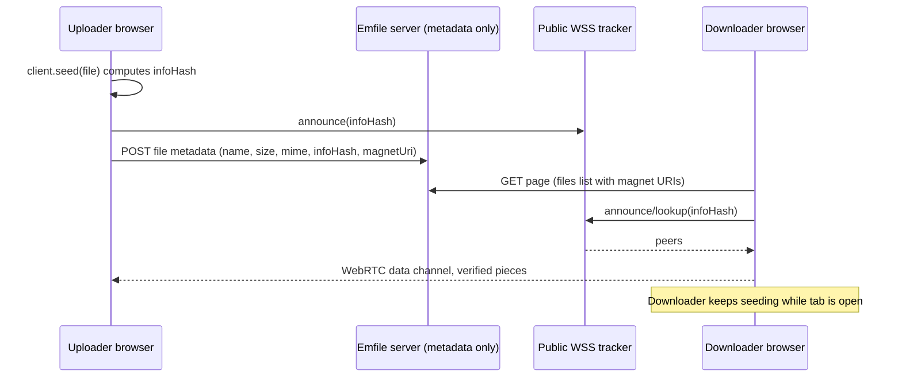

# Emfile — a linktree for files

Drop a file, get a shareable page like `emfile.site/file/math-book/`.
File bytes travel **peer-to-peer in the browser (WebTorrent/WebRTC)**;
the server hosts only the site and small metadata.

Bun is the only JS tooling: `bun install`, `bun run`, `bun test`.

## Quickstart

```bash
bun install
cp .env.example .env   # fill in BETTER_AUTH_SECRET etc.
bun run db:migrate      # creates ./local.db from ./drizzle
bun run dev             # http://localhost:3000
```

Checks: `bun run typecheck`, `bun test`, `bun run build`.

## Auth (username-only, no email in v1)

- Sign up / log in with **username + password** (Better Auth `username`
  plugin, `lib/auth.ts`). Usernames: case-insensitive, 3–30 chars,
  `^[a-z0-9_.-]+$`, same reserved words as slugs. Passwords 8–128 chars.
- Better Auth requires an `email` column: username signups store a synthetic,
  never-displayed `<random>@users.emfile.invalid` address (`.invalid` can
  never receive mail). Never shown, collected, or mailed.
- **Google OAuth** is the second method (`GOOGLE_CLIENT_ID/SECRET`).
  Automatic linking between Google and username accounts is disabled.
- **No account recovery in v1** — the signup form says: *"Emfile has no
  email, so we can't reset a lost password. Store it somewhere safe."*
- Adding email later is additive in `lib/auth.ts` (verification/reset
  handlers + UI). No Resend/SMTP/mail code exists anywhere.

## Google OAuth setup

1. Google Cloud Console → Credentials → OAuth client (Web application).
2. Redirect URI: `<BETTER_AUTH_URL>/api/auth/callback/google`.
3. Set `GOOGLE_CLIENT_ID` + `GOOGLE_CLIENT_SECRET`. The Google button stays
   visible but errors until they are set.

## Turso setup

1. Create a database; get URL + auth token.
2. Set `TURSO_DATABASE_URL` + `TURSO_AUTH_TOKEN`. Omit both locally to use
   `file:./local.db`.
3. `bun run db:migrate` applies `./drizzle` locally or to Turso; Vercel runs
   the same script before `next build` (`vercel-build` script).

## Vercel deploy

1. Import the repo; Vercel detects Bun from `bun.lock` (`bun install`).
2. Build command: `bun run vercel-build` (migrates Turso when configured,
   then `next build`). Node runtime for all API routes.
3. Env vars: `BETTER_AUTH_SECRET` (32+ chars), `BETTER_AUTH_URL` +
   `NEXT_PUBLIC_APP_URL`, Google keys (optional), Turso vars, `CRON_SECRET`,
   `NEXT_PUBLIC_TRACKERS` / `NEXT_PUBLIC_STUN` (optional), `REPORT_EMAIL`
   (footer display only).
4. `vercel.json` pins API functions to `iad` and adds a daily cron hitting
   `/api/cron/cleanup` (ownerless pages inactive > 180 days).

## P2P availability caveat

Pure P2P means **a file exists only while at least one peer holding it is
online**. Uploading seeds from your tab (close = stop seeding; the app warns
via `beforeunload` and shows a "Sharing from this tab" badge). Downloaders
join a swarm only on click; after ~20 s with no peers the UI says: *"No one
is sharing this file right now. Ask the uploader to open this page, or
re-seed it."* Successful downloads keep seeding while the tab is open.
"Seed again" verifies the recomputed infohash matches before re-seeding.
Small text files (≤ 256 KB) are stored inline in the DB — always available.
If a public tracker goes down, set `NEXT_PUBLIC_TRACKERS` / `NEXT_PUBLIC_STUN`.

## Architecture



Key files: `lib/torrent/provider.tsx` (singleton client in root layout),
`lib/torrent/client.ts` (lazy `/vendor/webtorrent.min.js` + npm fallback),
`components/text-editor.tsx` (`next/dynamic ssr:false`, lazy languages),
`app/file/[slug]/file-page-client.tsx` (SWR, revalidates on focus).

## Manual QA checklist

- [ ] Anonymous create, PIN set, second browser unlocks and edits
- [ ] "Anyone can edit" works without a PIN
- [ ] View-PIN blocks access until unlocked
- [ ] Private page is inaccessible when logged out (404)
- [ ] Username/password signup and login work with no email; Google works
- [ ] Dashboard create, update, delete
- [ ] Two-browser P2P transfer succeeds; seed again verifies infohash
- [ ] Inline text edit works; stale-revision save shows the 409 UI
- [ ] Landing to file page navigation does not interrupt seeding
- [ ] Layout correct at 375px, 768px, 1280px, light + dark themes

## Decisions where the spec was silent

- Slug availability: 400 ms debounced `GET /api/slug-check`.
- Unlock cookies: 30-day jose JWTs (`mp_u_<pageId>`); creator cookies
  (`mp_c_<pageId>`) persist per anonymous page with a "set a PIN" nudge.
- File pages are always `noindex`; only `public` pages expose OG metadata.
- Settings use Radix `Dialog` (scrollable, `max-h-90dvh` on mobile); swapping
  to a vaul Drawer on mobile is a one-file change in `settings-dialog.tsx`.

