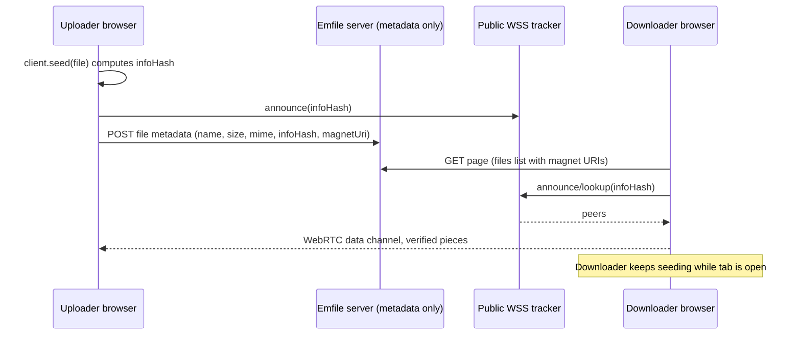

# Emfile — a linktree for files

Drop a file, get a shareable page like `emfile.site/file/math-book/`.
File bytes travel **peer-to-peer in the browser (WebTorrent/WebRTC)**;
the server hosts only the site and small metadata.

Bun is the only JS tooling: `bun install`, `bun run`, `bun test`.
Requires Bun >= 1.2.0 (see `engines.bun` in `package.json`).

## Quickstart

```bash
bun install
cp .env.example .env   # fill in BETTER_AUTH_SECRET etc.
bun run db:migrate      # creates ./local.db from ./drizzle
bun run dev             # http://localhost:3000
```

Checks: `bun run typecheck`, `bun test`, `bun run build`.

## Auth (username-only, no email in v1)

- Sign up / log in with **username + password** (Better Auth `username`
  plugin, `lib/auth.ts`). Usernames: case-insensitive, 3–30 chars,
  `^[a-z0-9_.-]+$`, same reserved words as slugs. Passwords 8–128 chars.
- Better Auth requires an `email` column: username signups store a synthetic,
  never-displayed `<random>@users.emfile.invalid` address (`.invalid` can
  never receive mail). Never shown, collected, or mailed.
- **Google OAuth** is the second method (`GOOGLE_CLIENT_ID/SECRET`).
  Automatic linking between Google and username accounts is disabled.
- **No account recovery in v1** — the signup form says: *"Emfile has no
  email, so we can't reset a lost password. Store it somewhere safe."*
- Adding email later is additive in `lib/auth.ts` (verification/reset
  handlers + UI). No Resend/SMTP/mail code exists anywhere.

## Google OAuth setup

1. Google Cloud Console → Credentials → OAuth client (Web application).
2. Redirect URI: `<BETTER_AUTH_URL>/api/auth/callback/google`.
3. Set `GOOGLE_CLIENT_ID` + `GOOGLE_CLIENT_SECRET`. The Google button stays
   visible but errors until they are set.

## Turso setup

1. Create a database; get URL + auth token.
2. Set `TURSO_DATABASE_URL` + `TURSO_AUTH_TOKEN`. Omit both locally to use
   `file:./local.db`.
3. `bun run db:migrate` applies `./drizzle` locally or to Turso; Vercel runs
   the same script before `next build` (`vercel-build` script).

## Vercel deploy

1. Import the repo; Vercel detects Bun from `bun.lock` (`bun install`).
2. Build command: `bun run vercel-build` (migrates Turso when configured,
   then `next build`). Node runtime for all API routes.
3. Env vars: `BETTER_AUTH_SECRET` (32+ chars), `BETTER_AUTH_URL` +
   `NEXT_PUBLIC_APP_URL`, Google keys (optional), Turso vars, `CRON_SECRET`,
   `NEXT_PUBLIC_TRACKERS` / `NEXT_PUBLIC_STUN` (optional), `REPORT_EMAIL`
   (footer display only).
4. `vercel.json` pins API functions to `iad1` and adds a daily cron hitting
   `/api/cron/cleanup` (ownerless pages inactive > 180 days).

## P2P availability caveat

Pure P2P means **a file exists only while at least one peer holding it is
online**. Uploading seeds from your tab (close = stop seeding; the app warns
via `beforeunload` and shows a "Sharing from this tab" badge). Downloaders
join a swarm only on click; after ~20 s with no peers the UI says: *"No one
is sharing this file right now. Ask the uploader to open this page, or
re-seed it."* Successful downloads keep seeding while the tab is open.
"Seed again" verifies the recomputed infohash matches before re-seeding.
Small text files (≤ 256 KB) are stored inline in the DB — always available.
If a public tracker goes down, set `NEXT_PUBLIC_TRACKERS` / `NEXT_PUBLIC_STUN`.

## Architecture



Key files: `lib/torrent/provider.tsx` (singleton client in root layout),
`lib/torrent/client.ts` (lazy `/vendor/webtorrent.min.js` via `webpackIgnore`
import — no npm fallback, the package root is Node-only),
`components/text-editor.tsx` (`next/dynamic ssr:false`, lazy languages),
`app/file/[slug]/file-page-client.tsx` (SWR, revalidates on focus),
`components/loading.tsx` (Spinner/Skeleton/Progress/LoadingButton/TopProgressBar).

## Loading states (every wait has one)

Shared primitives in `components/loading.tsx`, reused everywhere (no ad-hoc
spinners): route changes get `TopProgressBar` + `loading.tsx` skeletons;
slug checks show an inline spinner then check/cross; page creation, uploads,
downloads (Connecting → Found N peers → %/speed → Done + Cancel), saves,
unlocks, renames, deletes, and auth all use `LoadingButton` / `Progress` /
skeletons with matching error and empty states, `aria-busy` + `role="status"`
announcements, no layout shift, and `prefers-reduced-motion` support.

## Manual QA checklist

- [ ] Anonymous create, PIN set, second browser unlocks and edits
- [ ] "Anyone can edit" works without a PIN
- [ ] View-PIN blocks access until unlocked
- [ ] Private page is inaccessible when logged out (404)
- [ ] Username/password signup and login work with no email; Google works
- [ ] Dashboard create, update, delete
- [ ] Two-browser P2P transfer succeeds; seed again verifies infohash
- [ ] Inline text edit works; stale-revision save shows the 409 UI
- [ ] "New text file" creates an inline file directly
- [ ] Every file row on `/file/[slug]` shows its own Download button (inline and p2p files), on desktop and at 375px
- [ ] Double-clicking a text file opens the editor on desktop (single tap on touch); the buttons on the row do not trigger it; Enter opens it from the keyboard
- [ ] With the OS/browser set to dark mode, the editor opens dark (not light) with matching chrome, and re-themes live when the theme is toggled or the OS scheme changes, with no flash and no lost content/cursor
- [ ] Landing to file page navigation does not interrupt seeding
- [ ] Every wait has a loading state (upload, download, saving, route
  changes, lazy chunks, auth), with matching error states
- [ ] Loading UI causes no layout shift, respects `prefers-reduced-motion`,
  and is announced to screen readers
- [ ] "Go to:" section sits above the dropzone; typing a slug (or pasting a full emfile link) and pressing Enter or Go opens `/file/<slug>`; invalid input shows the inline error without navigating; an unknown slug lands on the friendly not-found screen whose **Create it** button pre-fills the landing slug field; it works at 375px and in both themes
- [ ] Layout is correct at 375px, 768px and 1280px, in light and dark themes

## Decisions where the spec was silent

- Slug availability: 400 ms debounced `GET /api/slug-check`.
- Unlock cookies: 30-day jose JWTs (`mp_u_<pageId>`); creator cookies
  (`mp_c_<pageId>`) persist per anonymous page with a "set a PIN" nudge.
- File pages are always `noindex`; only `public` pages expose OG metadata.
- Settings use Radix `Dialog` on desktop and vaul `Drawer` on mobile
  (`components/ui/drawer.tsx`, switched in `settings-dialog.tsx`).
- Slug lookups normalize case/whitespace centrally in `resolveAccess` /
  `loadPageBySlug`, so `/file/ABC` and API calls with any casing resolve to
  the same page instead of 404ing.
- Missing/private file pages render the `not-found` UI with `noindex` (no
  existence leak). Because the route has a `loading.tsx` Suspense shell, the
  shell streams first and the HTML status stays 200 with the not-found UI in
  place (documented Next.js behavior); the JSON API returns true HTTP 404s.
- Editor theming: `githubLightInit`/`githubDarkInit` (`@uiw/codemirror-theme-github`)
  with backgrounds/gutters/caret/selection overridden to the app's CSS vars;
  `theme` prop switches on `resolvedTheme` (the wrapper reconfigures in place,
  verified in its source — no remount, no lost content/cursor). `:root` sets
  `color-scheme: light dark` so native scrollbars/controls match.
- Every file row has its own Download button: inline content downloads as a
  Blob immediately; p2p runs the WebTorrent flow (Connecting → %/speed/ETA →
  Saving → Done). Icon-only under `sm` with `aria-label`, 44px targets.
- Text files open on double-click (desktop), single tap on coarse pointers
  (`e.detail === 0` detects keyboard Enter), with an explicit Edit/Open
  action; viewers get the editor read-only. Row chrome is `select-none` with
  `touch-action: manipulation`; buttons stop double-click propagation.
- Uploads render per-file "Adding…" rows (indeterminate progress, error +
  Retry); reorder is an optimistic position swap with rollback.
- "Go to:" parsing lives in `parseSlugInput` (`lib/slug.ts`, unit-tested):
  whitespace runs collapse to one hyphen, then the shared slug regex +
  reserved list decides. Paste-to-upload ignores events from inputs,
  textareas, selects and the editor, so form fields keep normal paste.
- `?slug=` pre-fills the landing slug field via `useSearchParams` read during
  render inside a `Suspense` boundary (no effect, no extra pass); the
  not-found screen's "Create it" links there. The landing route stays static.

